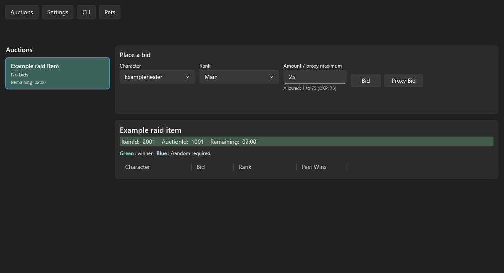
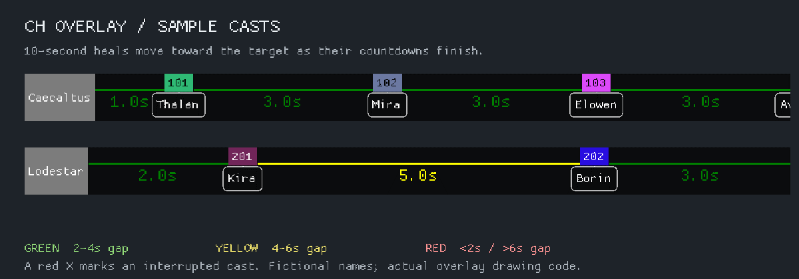

# DKP Watcher

DKP Watcher is a Windows desktop app for following OpenDKP auctions for the Mayhem guild on Project Quarm, displaying
CH timers over EverQuest, and receiving spoken pet alerts for pets needing healed or charm breaks.

**New here? Start with the illustrated [first-time setup guide](docs/First_Time_Use.md).**
It covers installation, saving your OpenDKP login, connecting, CH log setup,
and Pet Tools.

## Download

Open the [latest release](https://github.com/OkieDan/DkpWatcher-Releases/releases/latest)
and expand **Assets**.

| Download | Use it for |
| --- | --- |
| `DkpWatcher-v<version>-win-x64.msi` | A normal installation with optional Start menu and desktop shortcuts. Recommended for first-time setup. |
| `DkpWatcher-v<version>-win-x64.zip` | A standalone copy. Extract the complete ZIP before running `DkpWatcher.exe`. |

GitHub's **Source code** archives contain this public repository's documentation;
choose the versioned MSI or app ZIP to get DKP Watcher.

Both downloads require the **.NET 10 Desktop Runtime for Windows x64**, available
from [Microsoft's .NET download page](https://dotnet.microsoft.com/en-us/download/dotnet/10.0).

DKP Watcher is proprietary, closed-source software. The [binary license](LICENSE.txt)
allows free use, including business use, and free redistribution of unmodified
binaries with their license notices. Charging for the app, access to it, or its
distribution is prohibited. Third-party components retain their own terms in
[Third-party notices](THIRD-PARTY-NOTICES.txt). Both files accompany the installed
application and standalone ZIP.

## Get connected

1. Install and open DKP Watcher.
2. Open **Settings**, select **Mayhem** or **OpenDKP Demo**, then click **Manage**.
3. Enter your own OpenDKP username and password for that server, click **Save**,
   and close Connection Manager. Use **Connect** if needed.

The server profiles are already supplied. On a fresh start, **Mayhem** is selected.

*Example view from the app. See the [setup guide](docs/First_Time_Use.md) for the
complete walkthrough and screenshots.*

## Auctions and proxy bidding

Select an auction on the left to see its bids and remaining time on the right.
In **Place a bid**, choose your **Character** and **Rank**, then enter an
**Amount / proxy maximum**.

*The **Proxy Bid** button is at the top right of the bidding panel, beside
**Bid**. Enter the most DKP you want to spend in **Amount / proxy maximum**,
then click **Proxy Bid** to enable automatic bidding up to that limit.*

- **Bid** submits the entered amount once.
- **Proxy Bid**, to the right of **Bid**, uses the entered amount as your
  **maximum**, not your starting bid. It bids automatically as needed, increasing
  by 1 DKP above the highest observed bid while staying within your maximum,
  available DKP, and auction/rank limits. It waits while your character is an
  anticipated winner or another character you own leads the auction.
- Use **Stop Proxy** to cancel automatic bidding. Proxy bidding also stops when
  the auction closes or you disconnect; keep DKP Watcher open and connected for
  it to continue.

## Optional tools

Enable tools under **Settings → Other Tools**:

- **Enable PoP Flags** adds the **PoP** button, an opt-in Alpha tracker for Quarm
  progression. It works without an OpenDKP connection. See
  [PoP Flags Alpha setup](docs/First_Time_Use.md#pop-flags-alpha).
- **Enable CH Overlay** adds the **CH** button. It requires a Mayhem connection
  and local EQ logs. Follow the [CH Overlay and log setup](docs/First_Time_Use.md#7-set-up-ch-overlay-and-eq-logs).
- **Pet Tools** adds the **Pets** button for spoken pet alerts using local Zeal
  data. Follow the [Pets setup](docs/First_Time_Use.md#8-set-up-pets).

Choose the shared **EQ log directory** in **Settings**, directly above **Theme**.
CH Overlay and PoP Flags both use it; the folder is no longer configured in CH.
App screenshots in this guide use dark mode.

### CH overlay in action

*An ultra-low-resolution 16-second looping example using the actual overlay with fictional casts.*

For help with first-run problems, see
[Troubleshooting](docs/First_Time_Use.md#if-something-does-not-work).
