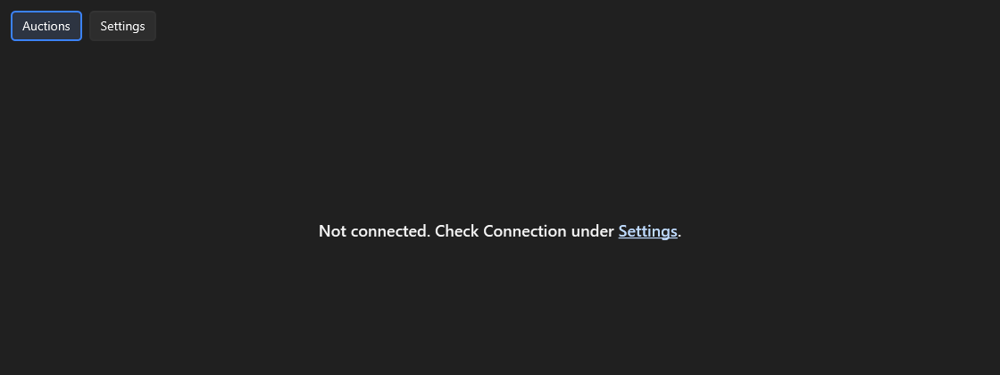
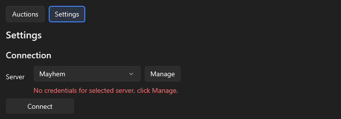
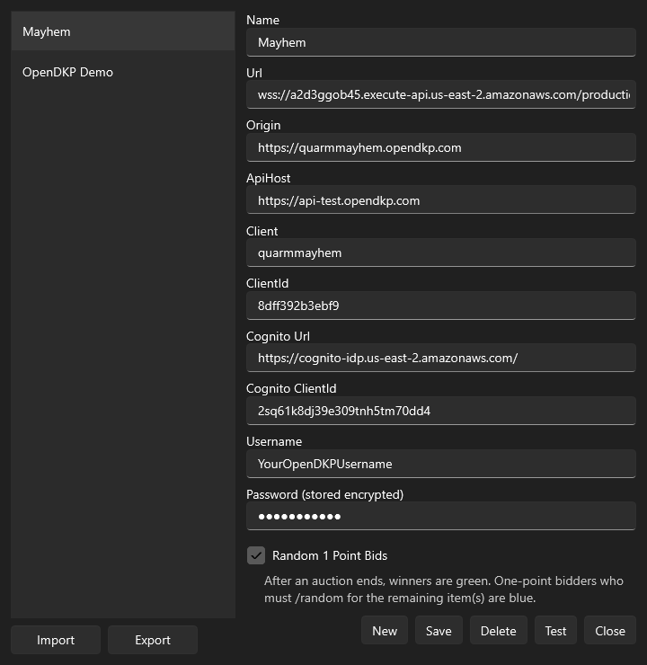
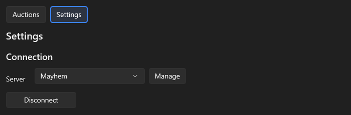
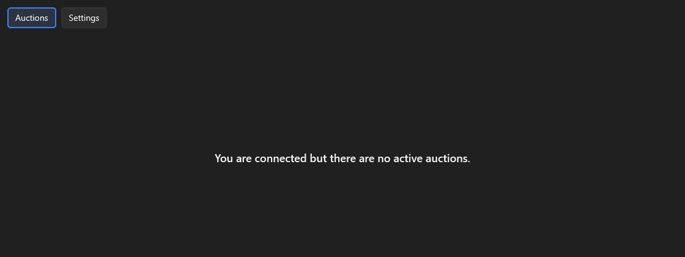
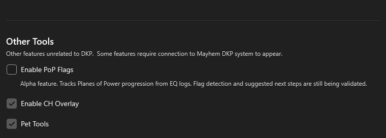
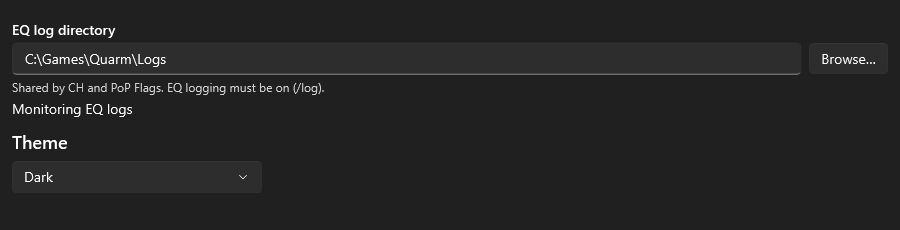
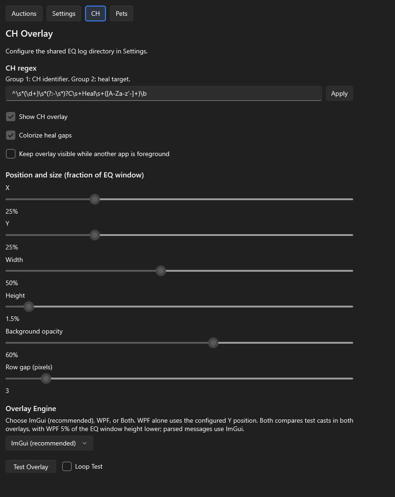
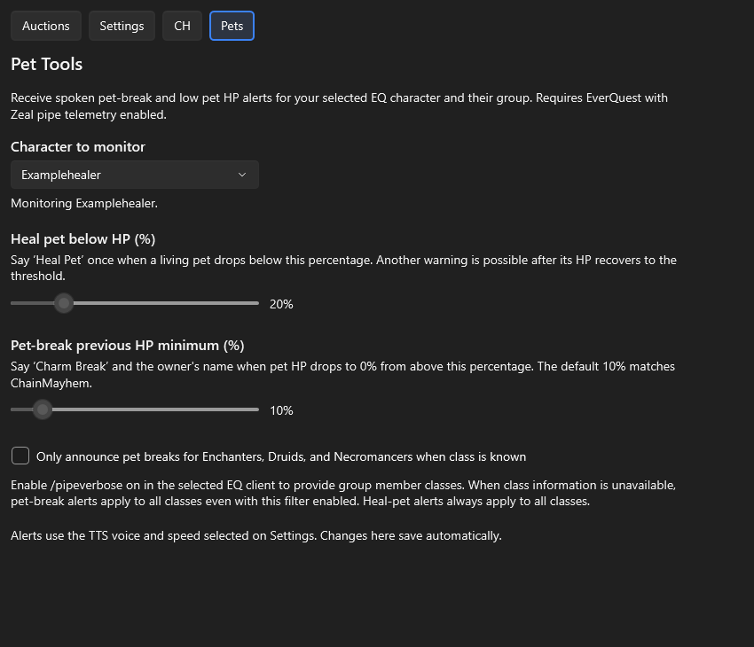

# DKP Watcher: first-time setup

This guide takes you from the downloaded Windows installer to a connected auction
board, then covers the optional CH Overlay, PoP Flags tracker, and pet alerts. Have your **OpenDKP
username and password for your server** ready. The tools also need EverQuest
running; Pets requires Zeal.

The app images below are rendered from the current interface with fictional
example data in dark mode. Window title bars are omitted. Choose your preferred
appearance under **Settings → Theme**; the screenshots do not change your theme.

Jump to: [Installation](#1-install-dkp-watcher) ·
[Login](#3-choose-your-server) · [Tools](#6-enable-the-optional-tools) ·
[CH Overlay and logs](#7-set-up-ch-overlay-and-eq-logs) ·
[Pets](#8-set-up-pets) · [Troubleshooting](#if-something-does-not-work).

## 1. Install DKP Watcher

You need Windows x64 and the **.NET 10 Desktop Runtime for Windows x64**.
If you do not already have the runtime, use Microsoft's
[.NET 10 download page](https://dotnet.microsoft.com/en-us/download/dotnet/10.0).
Under **Run apps**, find **.NET Desktop Runtime** and choose **Windows → x64**.

1. Open the downloaded file named `DkpWatcher-v<version>-win-x64.msi`.
2. Continue past the welcome screen.
3. On **Shortcuts**, choose where you want shortcuts:
   - **Create Start menu shortcuts (app and user guide)** is selected by default.
   - **Create a desktop shortcut** is optional.
4. Continue through the installation confirmation and wait for setup to finish.
5. Close the installer.

The installer adds DKP Watcher for your Windows user. Launch **DkpWatcher** from
the Start menu, or use the desktop shortcut if you selected one.

If you chose neither shortcut, open
`%LOCALAPPDATA%\Programs\DkpWatcher\DkpWatcher.exe`.

**Need the download again?** Open the
[DKP Watcher releases page](https://github.com/OkieDan/DkpWatcher-Releases/releases/latest)
and expand **Assets**. Choose the versioned **`.msi`** for this walkthrough.
The standalone app **`.zip`** is an alternative that you extract before running;
the **Source code** archives are not the app installer.

## 2. Open Settings on the first launch

On a fresh installation with no saved settings, the app opens on **Auctions**
and displays:

> Not connected. Check Connection under Settings.

This is expected: you have not saved your login yet.

Click the blue **Settings** link in that message. You can also use the **Settings**
button along the top of the window.

*Click Settings in the message or in the top navigation.*

## 3. Choose your server

Under **Settings → Connection**, check the **Server** dropdown.

| Server | Choose it when… |
| --- | --- |
| **Mayhem** | You want to connect to [Mayhem's OpenDKP site](https://quarmmayhem.opendkp.com). This is selected by default on a fresh start. |
| **OpenDKP Demo** | You have an account for the [OpenDKP demo site](https://demo.opendkp.com) and want to use that server. |

Both server profiles are supplied automatically. You do not need to create a new
connection or copy any server addresses.

Before credentials are saved for the selected server, you will see this red text:

> No credentials for selected server, click Manage.

Click **Manage** beside the dropdown.

*Manage opens Connection Manager with your selected server already selected.*

## 4. Save your OpenDKP login

In **Connection Manager**:

1. Check that the intended server is selected in the list on the left.
2. Find **Username** near the bottom of the form. Enter your OpenDKP login
   username for that server, rather than a character name.
3. Enter your OpenDKP password in **Password (stored encrypted)**.
4. Click **Save**, then dismiss the **Saved.** message.
5. Click **Close** to return to Settings.

**Leave the server addresses, ClientId, and Cognito fields at their supplied
values.** The two presets have different ClientId values; they are already filled
in for you. **Random 1 Point Bids** is checked by default for both new presets.

*The username in this image is an example. Use your own OpenDKP login.*

Your saved password is encrypted locally for your Windows user. The password box
may appear empty when you reopen Connection Manager; that alone does not mean
your saved password is missing. Check the red message in Settings instead.

## 5. Confirm the connection

After Connection Manager closes, the app attempts to connect using the saved
credentials. If it is still disconnected, click **Connect** under
**Settings → Connection**.

A successful connection has these signs:

- The title bar reads **Connected [Mayhem] - DKP Watcher**, or names your selected
  server instead of Mayhem.
- The button in Settings changes from **Connect** to **Disconnect**.
- The red missing-credentials message is gone.

*Disconnect indicates that the app is connected. You do not need to click it.*

Click **Auctions** along the top to return to the auction board.

If the server has no active auctions, this message is normal:

> You are connected but there are no active auctions.

*An empty auction board can still be connected. Auctions appear as the server
sends them.*

**Your OpenDKP connection is ready.** You can leave the app open while waiting for
auctions. Continue below if you want to use the optional tools.

## 6. Enable the optional tools

The **Options** section just above **Other Tools** controls two optional navigation
buttons. Check **Restricted Item Alerts** to show **Restricted Items**, or
**Show Auction History for This Session** to show **History**. Both are unchecked
by default, and your choices are saved for future launches.
Unchecking either option hides its button. Existing restricted items still
trigger their configured TTS/sound alerts, and auction history continues to be
recorded for the current session while its button is hidden.

Open **Settings** and scroll down to **Other Tools**. Each checkbox enables its tool
and adds a button to the top navigation:

| Settings checkbox | Navigation button | What it needs |
| --- | --- | --- |
| **Enable PoP Flags** | **PoP** | Quarm progression output in EQ logs. Alpha feature, off by default; it works without an OpenDKP connection. |
| **Enable CH Overlay** | **CH** | An active **Mayhem** connection, EverQuest running, and EQ logging enabled. This checkbox appears only while connected to Mayhem. |
| **Pet Tools** | **Pets** | EverQuest running with Zeal pipe data available. It works without an OpenDKP connection and does not use the EQ log directory. |

*CH Overlay and Pet Tools are enabled in this example; PoP Flags is off. Enable
only the tools you want to use.*

Uncheck a tool to stop it and hide its navigation button. Changes save
automatically. CH stops when the Mayhem connection is lost; Pets can continue
monitoring independently. Turning off PoP Flags retains saved flags and overrides
and leaves CH log monitoring active if CH is enabled.

The shared **EQ log directory** is higher up on **Settings**, directly above
**Theme**. CH Overlay and PoP Flags use the same folder; it is not configured in
the CH view. Existing CH folder settings migrate automatically.

### PoP Flags Alpha

Choose the shared log folder above **Theme**, enable **Other Tools → Enable PoP
Flags**, and open **PoP** in the top navigation. Follow **Update your flags
in game** in that view: reconcile stored memories at the Seer, visit Grand
Librarian Maelin, revisit as needed while new flags are granted, then capture
`guided meditation` and `#popflags 1` through `#popflags 5`.

Choose **All** to compare characters, or select a character for its **Access** and
**Progression** rows and tier-by-zone checklist. Hover a square for entry
requirements or completed/missing flags. Blue progression numbers count completed
flags; green completed zones have no number. Unverified credit stays distinct
from missing credit. Flag detection and guidance are still being validated.

Before setting up spoken pet alerts, choose **TTS Voice** and **TTS Speed** higher
up in Settings, then click **Test TTS**. Make sure you can hear the test through
the Windows audio output you intend to use while playing.

## 7. Set up CH Overlay and EQ logs

CH Overlay displays timers based on CH announcements written to your local EQ
log. Connect to **Mayhem**, enable **Settings → Other Tools → Enable CH Overlay**,
then configure the shared log folder in **Settings** as described below. Open
**CH** afterwards for the overlay's appearance, regex and test controls.

### Turn on EQ logging and choose the folder

1. Log into your EQ character and enter `/log on` in the game's chat input.
2. Locate the folder where that EQ client writes files named `eqlog_*.txt`, such
   as `eqlog_Examplehealer_pq.proj.txt`.
3. In DKP Watcher's **Settings** page, find **EQ log directory** directly above
   **Theme**, click **Browse...**, and select that folder.
4. Check the status message below the path.

Choose the **folder containing the files**, rather than a single log file or its
parent directory. Depending on your EQ installation, the files may be in the
main EQ folder or a `Logs` subfolder. `C:\Games\Quarm\Logs` in the image below
is only an example. If you type a path instead of browsing, press **Tab** or click
another control to apply it.

| Log-directory message | Meaning / next step |
| --- | --- |
| **EQ log directory not configured** | Choose the folder with **Browse...** above **Theme** in Settings. |
| **EQ log directory unavailable** | Check the path and that the folder is accessible. |
| **Idle** | The folder is configured, but no active tool is currently using it. Enable CH while connected to Mayhem, or enable PoP Flags. |
| **Idle; no matching log files** | No tool is monitoring and the selected folder has no matching logs. Check logging and the selected folder. |
| **Monitoring; no matching log files yet** | Monitoring is active, but the folder has no `eqlog_*.txt` files yet. Check logging and the selected folder. |
| **Monitoring EQ logs** | The shared monitor is active. Confirm your character's log is receiving new lines. |

*Use your own EQ log directory. The illustrated path and successful status are
example data.*

Return to **CH** to configure and test the overlay. Its view points you back to
Settings for the shared log folder.

### Test the overlay

1. Keep EQ open and not minimized.
2. Leave **Show CH overlay** checked.
3. Click **Test Overlay**, then look over the EQ window for the test row. It lasts
   about ten seconds; click again if you miss it.
4. Adjust **X**, **Y**, **Width**, or **Height** if needed, then test again.

The test checks the visual overlay without needing a real CH announcement. It
does **not** prove that EQ logging or the selected directory is working. For a
live check, wait for a new matching CH announcement while the log is being
watched. Existing log history is not replayed when watching starts.

Keep the default **CH regex** during first-time setup. It recognizes announcement
text such as `1 C Heal Exampletank` or `1 - C Heal Exampletank`, where the number
is the CH identifier and the name is the heal target. The announcement must
reach your character's log. A cast without a matching chat announcement will
not create a timer. If your group's announcement format is different, get help
adjusting the expression; use **Apply** to save a regex change.

| Display option | What it changes |
| --- | --- |
| **Show CH overlay** | Shows or hides the overlay rows. |
| **Colorize heal gaps** | Adds color coding to the time gaps between heals. |
| **Keep overlay visible while another app is foreground** | Keeps it visible when you switch away from EQ and DKP Watcher. Useful while arranging your windows. |
| **X / Y** | Positions the overlay as a fraction of the EQ window. |
| **Width / Height** | Sizes the rows relative to the EQ window. |
| **Background opacity** | Adjusts the background's transparency. |
| **Row gap (pixels)** | Adjusts spacing between stacked rows. |

Position and display changes save automatically. A blank overlay is normal when
there are no active matching CH announcements or test casts.

## 8. Set up Pets

Pets provides spoken low-pet-HP and possible pet-break alerts for the selected
EQ character and their group. You can use it with any character class.

1. Run EQ with your server's supported **Zeal** installation. DKP Watcher needs
   its local pipe data; no EQ log-directory selection is needed for this tool.
2. Enable **Settings → Other Tools → Pet Tools** and click **Pets** along the top.
3. Choose **Character to monitor**. A single detected character is selected
   automatically; with multiple EQ clients, select the one whose group you want
   to monitor.
4. Look for **Monitoring &lt;character name&gt;.** beneath the selector.
5. Start with the default thresholds below, then adjust them to suit your use.

*Examplehealer is a fictional character. Select your own running EQ character.*

| Control | Default | Behavior |
| --- | --- | --- |
| **Heal pet below HP (%)** | **20%** | Says “Heal Pet” when a living pet drops below the threshold. Another warning can occur after its HP recovers to the threshold and drops below it again. |
| **Pet-break previous HP minimum (%)** | **10%** | Says “Charm Break” and the owner's name when pet HP changes from above this percentage to 0%. A pet death can also trigger this alert; it is not proof of a charm break. |
| **Only announce pet breaks for Enchanters, Druids, and Necromancers when class is known** | **Off** | Restricts pet-break alerts for owners whose classes are known. Heal-pet alerts still apply to all classes. |

For example, at the default settings, **20% → 19%** can produce a heal alert,
and **11% → 0%** can produce a pet-break alert. **10% → 0%** does not pass the
default pet-break minimum.

For the optional class filter, enable Zeal's verbose group output. Use its
`/pipeverbose` command and check the in-game response to confirm verbose output
is **on**; it is a toggle in the
[Zeal command reference](https://github.com/CoastalRedwood/Zeal#commands).
Without class information, pet-break alerts still apply to owners of unknown
class, even when the filter is checked.

Pet alerts use the voice and speed chosen in **Settings**. Changes in Pets save
automatically; there is no Save button. The first received sample, changing
characters, zoning, or reconnecting establishes a new baseline, so an existing
condition does not immediately generate an alert. Uncheck **Pet Tools** in
Settings to stop monitoring and cancel queued pet alerts.

For more detail, see the [Pet Tools reference](Cleric_Tools.md).

## The next time you open the app

DKP Watcher remembers the last server it successfully connected to and attempts
to reconnect with your saved credentials. You normally only enter your password
again when it changes or you set up another server.

To switch servers, open **Settings** and change **Server**. Credentials are saved
separately for each profile. If the new selection shows the red message, use
**Manage** to save credentials for it. When already connected, selecting another
server switches the connection; otherwise, use **Connect** if needed.

If the connection drops unexpectedly, the app attempts to reconnect automatically
and the title bar shows **Reconnecting to…**. In Settings, **Stop reconnecting**
lets you stop those attempts.

## If something does not work

| What you see | What to do |
| --- | --- |
| Windows says .NET is required. | Install the **.NET 10 Desktop Runtime, Windows x64** linked in step 1, then open the app again. |
| **Not connected** on the first launch. | Open **Settings → Manage**, save your login for the selected server, and close Connection Manager. |
| The red credentials message remains. | Check the selected server, then save both a nonblank username and a password for that profile. |
| Connection fails after saving. | Confirm the selected server and verify that your login works on that server's OpenDKP website. Re-enter the password in **Manage**, save, close, and try **Connect**. |
| The password box is empty after reopening Manage. | This can be normal for a saved password. Use the red message in Settings to check whether credentials are missing. |
| **Connected**, but no auctions appear. | The server may have no active auctions. You do not need to reconnect just because the board is empty. |
| The app says **Reconnecting**. | Allow it to recover. To change credentials or reconnect manually, use **Stop reconnecting**, then **Manage** or **Connect**. |
| **Enable CH Overlay** or the **CH** button is missing. | Connect to **Mayhem**. Then enable **Settings → Other Tools → Enable CH Overlay**. The option is unavailable on Demo and while disconnected. |
| The log-directory status reports an unavailable folder or no files. | Open **Settings → EQ log directory**, directly above **Theme**. Turn on `/log on` in EQ and select the folder actually containing `eqlog_*.txt` files. The app does not search subfolders. |
| The **PoP** button is missing. | Enable **Settings → Other Tools → Enable PoP Flags**. It works without an OpenDKP connection; use the shared EQ log directory above **Theme**. |
| **Test Overlay** works, but live CH timers do not. | Confirm the active EQ log is receiving new lines and that new CH announcements match the configured expression. The test does not read the logs. |
| The overlay is invisible. | Keep EQ open and not minimized, check **Show CH overlay**, and try **Test Overlay**. Check position/size and foreground visibility; the overlay is blank when it has no active rows. |
| The **Pets** button is missing. | Enable **Settings → Other Tools → Pet Tools**. This does not require an OpenDKP connection. |
| Pets says **Waiting for EQ characters with Zeal pipe telemetry.** | Make sure EQ and Zeal are running and supplying pipe data. The app retries discovery automatically. |
| No spoken pet alerts. | Select the intended character, check **Monitoring…**, and try **Test TTS** in Settings. Alerts need a new threshold crossing after the baseline is established. |

If you ask for help, include the selected server and the connection message or
title bar. Never send your password or your `settings.json` file.
